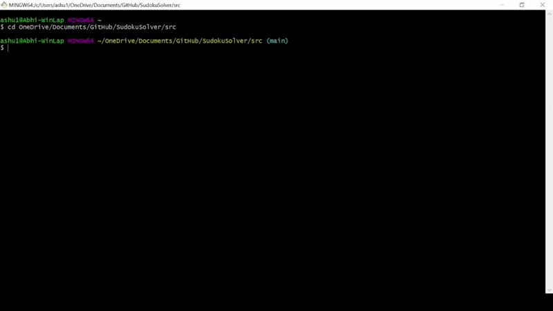

# :1234: SUDOKU SOLVER

## :open_book: OVERVIEW
Feb 2024 - Mar 2024\
Developer(s): Ashneet Rathore

Sudoku Solver is a program that uses AI-based constraint satisfaction techniques, such as heuristics and backtracking search, to efficiently solve Sudoku boards. Users can supply their own board or generate one, select different solving heuristics, and receive the completed board along with statistics tracking the algorithm's solving performance.

## :film_strip: DEMO


## :gear: HOW IT WORKS
Written in **Python**, the program models a Sudoku board as a **Constraint Satisfaction Problem (CSP)**. A CSP is a type of problem where variables must be assigned values from specificied domains such that all constraints, or rules, are satisfied. In Sudoku, each cell is a variable whose domain consists of all digits still allowed based on the current state of its row, column, or subgrid. The constraints are simply the rules of Sudoku - each digit can appear exactly once per row, column, and subgrid. As assignments are made, domains are continually reduced, shrinking the search space toward a consistent, completed state.

The solver uses **backtracking search**, a variation of depth-first search, to incrementally assign values while checking for consistency at each step. If a constraint violation occurs, the search retreats and explores alternative assignments. To implement the backtracking mechanism, the solver maintains a **stack-based trail** that records every reversible change, allowing the search to restore the most recent consistent state. 

To improve efficiency, combinations of different **heuristics** can be applied to reduce the search space, prioritize assignments that are less likely to cause constraint violations, and eliminate invalid solutions earlier:

1. Variable selection determines which unassigned variable to assign next.
    - **Minimum Remaining Value (MRV)** selects the variable with the smallest domain.
    - **Minimum Remaining Value with Maximum Degree (MAD)** extends MRV by applying a tie-breaking rule (when multiple variables share the smallest domain) that selects the most constrained variable (with the most unassigned neighbors) 

2. Value selection determines which value to assign to a selected variable.
    - **Least Constraining Value (LCV)** chooses the value that restricts the fewest options for neighboring variables.

3. Consistency checking checks that an assignment does not violate any constraints.
    - **Forward Checking (FC)** eliminates illegal values from neighbors after each assignment.
    - **Norvig Checking (NOR)** extends FC by additionally assigning values with only one possible position within a constraint.

## :open_file_folder: PROJECT FILE STRUCTURE
```bash
sudoku-solver/
│── src/
│   │── main.py                 # App entry point
│   │── sudoku_board.py         # SudokuBoard class
│   │── bt_solver.py            # BTSolver class
│   │── constraint_network.py   # ConstraintNetwork class
│   │── constraint.py           # Constraint class
│   │── domain.py               # Domain class
│   │── variable.py             # Variable class
│   │── trail.py                # Trail class
│   └── board_generator.py      # Board generation logic
│── README.md                   # Project documentation
│── .gitignore                  # Ignored files
└── demo.gif                    # Demo GIF
```

## :rocket: EXECUTION
**1. Clone the repository**
```bash
git clone https://github.com/ashneetrathore/sudoku-solver.git
```

**2. Run the program**
> [!IMPORTANT]
> This command runs without heuristics. See the next section to specify heuristics and other options.
```bash
cd sudoku-solver/src
python3 main.py
```

## :wrench: TRY IT OUT

### :hammer: **Board Generation Options**
To generate unsolved boards with custom options, use the following command format:
```bash
python3 board_generator.py <base_file_name> <num_boards> <p> <q> <m>
```
`base_file_name` - base name for generated `txt` files (e.g. `puzzle` -> `puzzle_0.txt`, `puzzle_1.txt`, ...)\
`num_boards` - number of boards to generate\
`p` - number of rows in a subgrid\
`q` - number of columns in a subgrid\
`m` - number of pre-filled cells in the board

Example command that generates 4 board files (with base name `puzzle`), with 3x3 subgrids and 7 pre-filled cells:
```bash
python3 board_generator.py puzzle 4 3 3 7
```

Typical Sudoku board sizes and recommended `m` values:
| Board Size | `p`×`q`   | Recommended `m`|
|------------|-----------|----------------|
| 9×9        | 3×3       | 7              |
| 12×12      | 3×4       | 15             |
| 16×16      | 4×4       | 25             |
| 25×25      | 5×5       | 50             |

> [!IMPORTANT]
> All boards will be generated to the `boards/` directory inside the project root.

### :card_index_dividers: **Input File Options**

`main.py` accepts three forms of input for the board(s):

| Option                                                                       | Command                                  |
|------------------------------------------------------------------------------|------------------------------------------|
| No filename - solver runs on a randomly generated board (`p=3`,`q=3`, `m=7`) | `python3 main.py`                        |
| Single file - solver runs on the specified board file                        | `python3 main.py ../boards/puzzle_1.txt` |
| Directory - solver runs on all board files in the specified directory        | `python3 main.py ../boards` |


### :running_woman: **Heuristic Options**

The solver supports heuristics to improve efficiency. Select **one heuristic per category** or omit to apply none. Heuristics can be specified in any order.

| Category             | Description                                                  | Options  |
|----------------------|--------------------------------------------------------------|----------|
| Variable selection   | Decides which unassigned variable to assign next             | MRV, MAD |
| Value selection      | Decides which value, for a selected variable, to assign next | LCV      |
| Consistency checking | Checks that an assignment does not violate constraints       | FC, NOR  |

Example commands for common heuristic combinations:

| Level   | Commands                          |
|---------|-----------------------------------|
| Okay    | `python3 main.py`                 |
| Medium  | `python3 main.py MRV FC`          |
| Good    | `python3 main.py MRV LCV FC`      |
| Best    | `python3 main.py MAD LCV NOR`     |

> [!WARNING]
> Applying few or no heuristics to a large board (16x16 or 25x25) may cause the solver to fail to find a solution.

## :printer: UNDERSTANDING THE OUTPUT
After solving, the program prints information about the algorithm's performance. Here are some definitions to interpret these analytics:

**Trail pushes** are recorded whenever the solver makes a new assignment, meaning it tentatively assigns a value to a selected variable.

**Backtracks** occur when the solver discovers that its current state violates a constraint and as a result, it undoes previous assignments to restore consistency. Fewer backtracks generally indicate that applied heuristics are successfully reducing the search space.

> [!NOTE]
> When the input is a directory, each solved board is saved back to its `txt` file and the solver reports how many boards were successfully solved. Otherwise, the solution is printed to the terminal.